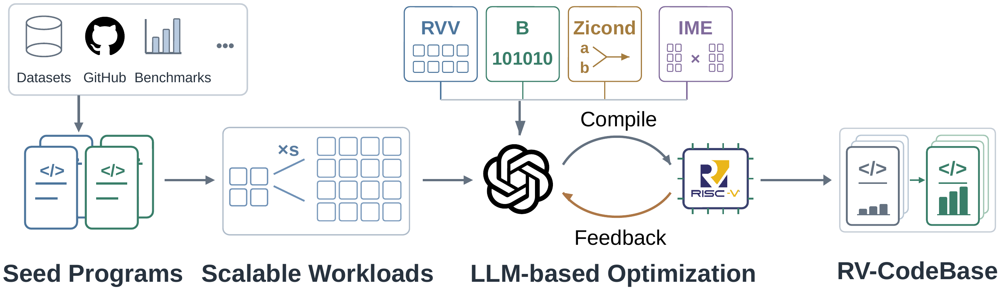

# 🌾 RV-CodeBase: A Comprehensive Dataset for LLM-based Code Optimization on RISC-V

RV-CodeBase is, to the best of our knowledge, the first systematic dataset for code optimization on RISC-V. It addresses the gap between functional correctness and hardware-specific optimization in existing code corpora and provides resources for LLMs to acquire RISC-V-specific capabilities. RV-CodeBase consists of two core components:

1. A **RISC-V instruction knowledge base** with fine-grained specifications, intrinsic mappings, and usage examples for RISC-V extensions, including RVV, Zbb, Zbc, and Zicond.
2. A collection of **code optimization pairs**, where each baseline program is paired with a RISC-V-optimized version produced under the guidance of the instruction knowledge base and verified on hardware.

Built on top of these, RV-CodeBase also supports two downstream tasks: (1) RAG-based RISC-V instruction question answering and (2) optimization-oriented code generation and evaluation.

- 🤗 HF Dataset: [RV-CodeBase/dataset](https://huggingface.co/datasets/RV-CodeBase/dataset)
- 🤗 HF Models:
  [Qwen3.5-9B-SFT](https://huggingface.co/RV-CodeBase/qwen3.5-9b-sft),
  [Qwen3.5-27B-SFT](https://huggingface.co/RV-CodeBase/qwen3.5-27b-sft),
  [Gemma4-12B-SFT](https://huggingface.co/RV-CodeBase/gemma4-12b-sft),
  [Gemma4-31B-SFT](https://huggingface.co/RV-CodeBase/gemma4-31b-sft),
  [DeepSeek-Coder-7B-SFT](https://huggingface.co/RV-CodeBase/deepseek-coder-7b-sft),
  [DeepSeek-Coder-33B-SFT](https://huggingface.co/RV-CodeBase/deepseek-coder-33b-sft),
  [CodeLlama-13B-SFT](https://huggingface.co/RV-CodeBase/codellama-13b-sft),
  [CodeLlama-34B-SFT](https://huggingface.co/RV-CodeBase/codellama-34b-sft)

## Overview



## Features

- **First-of-its-kind RISC-V optimization dataset:** focuses on hardware-specific optimization rather than only functional correctness, targeting the open-source RISC-V ISA and its modular extensions.
- **RISC-V instruction knowledge base:** structured from official RISC-V specifications into entries that capture functional semantics, instruction formats, intrinsic interfaces, and usage examples.
- **Optimization pair collection:** seed programs are gathered from multiple sources (benchmarks, open-source datasets, and projects), scaled with adjustable workload factors, and rewritten by LLMs guided by the RISC-V knowledge base.
- **Hardware-verified pipeline:** specification modeling, program collection and scaling, LLM-based optimization, and hardware verification are integrated into a single data generation pipeline.
- **Two downstream tasks:** RAG over the RISC-V knowledge base for instruction QA, and optimization-oriented code generation with reproducible evaluation scaffolding.

## Installation

RV-CodeBase uses a two-machine setup: a **host machine** runs the Python pipeline (data collection, LLM-based optimization, and prompt orchestration), and a **64-bit RISC-V machine with RVV support** builds, executes, and verifies the generated programs.

**1. Host machine: Python environment**

```bash
conda create -n rvcodebase python=3.11 -y
conda activate rvcodebase
pip install -r requirements.txt
```

**2. RISC-V machine: build and verification**

Prepare a 64-bit RISC-V machine with RVV support and a working C/C++ toolchain. The benchmark scripts compile with `-march=rv64gcv -mabi=lp64d` by default.

```bash
# Debian / Ubuntu
sudo apt update && sudo apt install -y g++

# CentOS / Rocky / AlmaLinux
sudo yum install -y gcc-c++
```

After the host machine produces the dataset artifacts, sync them to the RISC-V machine and run the build and verification scripts there to compile and execute each generated program, collecting correctness and performance results.

## Download

Download the RV-CodeBase dataset artifacts and fine-tuned models from Hugging Face:

```bash
# Dataset
python download.py --subset benchmark rag sft pipeline

# Fine-tuned models
python download.py --subset models
```

## Generate RV-CodeBase

The dataset construction pipeline runs stage by stage, with each stage producing JSONL artifacts under `data/` for inspection and reuse. Each stage script is runnable on its own, so the pipeline can be executed end to end or replayed from any intermediate JSONL.

## Benchmark Tasks

Both tasks call an OpenAI-compatible chat endpoint configured in the repo-level `llm_config.env`:

```text
api_base_url = http://<host>:<port>/v1
api_key      = <key or EMPTY>
model        = <model name>
temperature  = 0
```

### RAG-based RISC-V Instruction QA

Run any of the five QA settings against `benchmark/data/questions.jsonl`. Each runner writes `predictions.jsonl` under `benchmark/results/qa/<method>/`:

```bash
# No-RAG: model-only baseline
python3 benchmark/methods/qa/no_rag/run.py     --method no-rag --jobs 8

# DenseRAG (TextRAG): embedding retrieval over the RISC-V knowledge base
python3 benchmark/methods/qa/text_rag/run.py   --method text-rag --jobs 8 --top-k 3

# BM25: sparse lexical retrieval over the same DenseRAG chunks
python3 benchmark/methods/qa/bm25/run.py       --method bm25-rag --jobs 8 --top-k 3

# HybridRAG: reciprocal-rank fusion of BM25 and embedding retrieval
python3 benchmark/methods/qa/hybrid_rag/run.py --method hybrid-rag --jobs 8 --top-k 3 --candidate-k 10

# GraphRAG: knowledge graph retrieval over the RISC-V knowledge base
python3 benchmark/methods/qa/graph_rag/run.py  --method graph-rag --jobs 8 --top-k 5
```

Score predictions and aggregate:

```bash
python3 benchmark/eval/qa/eval_qa.py       --method <method>   # writes metrics.jsonl
python3 benchmark/eval/qa/aggregate_qa.py  --method <method>   # writes summary.json

# Classify questions and compare each QA method by question category
python3 benchmark/eval/qa/analyze_categories.py \
    --methods <method1>,<method2>,<method3>
```

### Code Optimization on TSVC, PolyBench/C, RAJAPerf

Run a model on each benchmark; results land at `benchmark/results/<bench>/<model>/results.jsonl`:

```bash
python3 benchmark/methods/tsvc/run.py        --output benchmark/results/tsvc/<model>/results.jsonl
python3 benchmark/methods/polybenchc/run.py  --output benchmark/results/polybenchc/<model>/results.jsonl
python3 benchmark/methods/rajaperf/run.py    --output benchmark/results/rajaperf/<model>/results.jsonl
```

Score per-run and build the cross-model summary table:

```bash
python3 benchmark/eval/perf/summary.py \
    --input benchmark/results/<bench>/<model>/results.jsonl
python3 benchmark/eval/perf/export_xlsx.py \
    --results-root benchmark/results \
    --output benchmark/results/summary_table.xlsx
```
